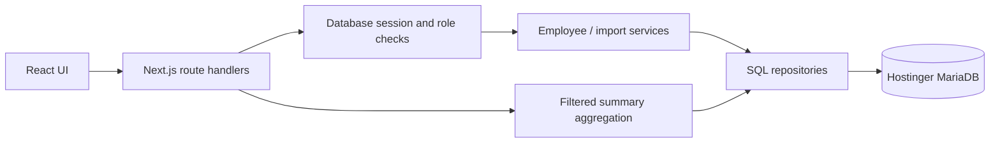
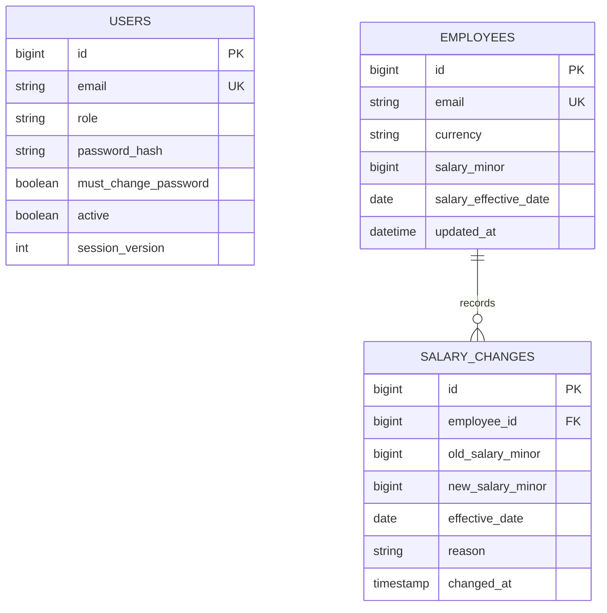

# Architecture and decisions

- A React UI calls small Next.js route handlers. The handlers delegate business decisions to services, SQL to repositories, and database setup to an explicit migration script. Server-side pagination keeps employee list responses bounded at 10,000 records. The Recently updated sort uses the employee's database update timestamp, so salary edits and imported changes appear first; equal timestamps use employee ID for stable ordering.
- MySQL-compatible tables and queries are used locally and in production. This follows the user's Hostinger Web/Cloud database choice: those plans provide MariaDB rather than PostgreSQL. Local MySQL validates integration workflows; the dedicated Hostinger MariaDB 11.8.9 database was connected successfully and migrations plus employee/user seeds completed. Hosted UI verification is recorded separately in verification notes.
- Store pay as integer minor units with an explicit currency. Never sum pay across currencies. The assessment supports five country/currency pairs with two decimal places. Inputs cap annual salary at 1,000,000,000 minor units, keeping 10,000-record payroll totals within safe JavaScript integer range.
- Salary changes lock the employee row, update current pay, and insert an audit event in one transaction. Failed or unchanged changes roll back.
- The dashboard reads 10,000 salary rows on the server and computes currency-specific medians, payroll totals, and bands. This is simple and portable across MySQL and MariaDB at the assessment's fixed scale. The summary endpoint returns aggregate rows only; the employee directory separately returns paginated employee records. At much larger scale, precomputed aggregate tables or database window queries would be preferable.
- Synthetic seed data uses a fixed algorithm and stable IDs. Rerunning it does not duplicate employees or overwrite changes.
- Spreadsheet preview parses and validates the file without writing. Apply reparses it, locks matching employee rows, stages up to 10,000 rows in a temporary table, and uses set-based SQL inside one transaction. Matching email updates names and department; salary changes add a history entry. Existing country, currency, and start date must match so an audit entry never loses the meaning of its currency or employment period.
- The API owns validation and constraints. UI validation improves feedback but is not a security boundary.
- Users are stored in MySQL with salted scrypt password hashes, role, initial-password flag, active flag, and session version. A unique generated admin slot limits the database to one admin. Signed cookies identify a user; every request checks the current database account and session version. Initial passwords must be changed before salary access.

## Account and chart decisions

- `users` stores unique emails, names, admin/HR roles, salted scrypt password hashes, initial-password and active flags, and a session version. A unique generated admin slot permits at most one admin. The seed creates one admin when absent; no app endpoint creates admins.
- `npm run seed:users` creates 20 HR accounts and generates independent temporary passwords. Existing accounts are preserved. Credentials are written only to ignored `.data/seed-user-logins.txt`; account credentials are not configured in environment variables. Environment configuration contains the database connection and session signing secret.
- The admin can add, enable, disable, and reset HR users. Initial and reset passwords must be changed before salary access. Password changes, resets, and enable/disable operations increment the session version, invalidating older cookies. HR users can change their own passwords but cannot manage accounts.
- The HR list includes active and disabled accounts, newest first. Search and 10-row pagination run in the browser over the admin-only account list; employee directory search and pagination run in SQL. This keeps the small assessment account list simple; larger HR directories should paginate on the server.
- Overview charts reuse summary aggregates without another database query or chart dependency. Department headcount sums employee counts across currencies; salary bands show one currency at a time. Bar/Donut controls are independent, and selections last while the Overview component remains mounted. Animations respect reduced-motion preferences.
- Clicking the sidebar avatar, name, or role opens Account. Logout remains at the bottom of the sidebar. Employee creation is available in the Employees section.

## AI use

AI helped draft the requirements, implementation, and tests. Engineering checks include running the unit suite, exercising a real local MySQL database, reviewing transaction boundaries, recording a browser demo, and documenting limits. The original assessment PDF remains in the repository as the source of requirements.

## Request flow

Users are application identities; employee records are salary subjects and are not login accounts. Salary history currently does not identify the acting HR user. Adding an actor foreign key and access auditing would be a distinct enhancement.

## Concrete use of AI and human decisions

AI drafted code, documentation, validation cases, and browser automation. Scope decisions came from the assessment and user: Node.js/TypeScript, MySQL compatibility for Hostinger, matching-email imports that update existing records, one admin, and managed HR accounts. AI suggestions were checked against those decisions rather than accepted as requirements.

Review corrections included replacing the original environment-based shared login with database accounts; checking account controls in an actual browser after unstyled buttons were reported; correcting the demo automation to wait for asynchronous filter responses and import confirmation; and separating build success from proof that a deployed database-backed app works. Fast unit tests check rules, SQL smoke checks verify real transactions, and browser workflows verify the interaction between routes, authentication, and UI. No benchmark numbers or verification claims are inferred from code alone.
